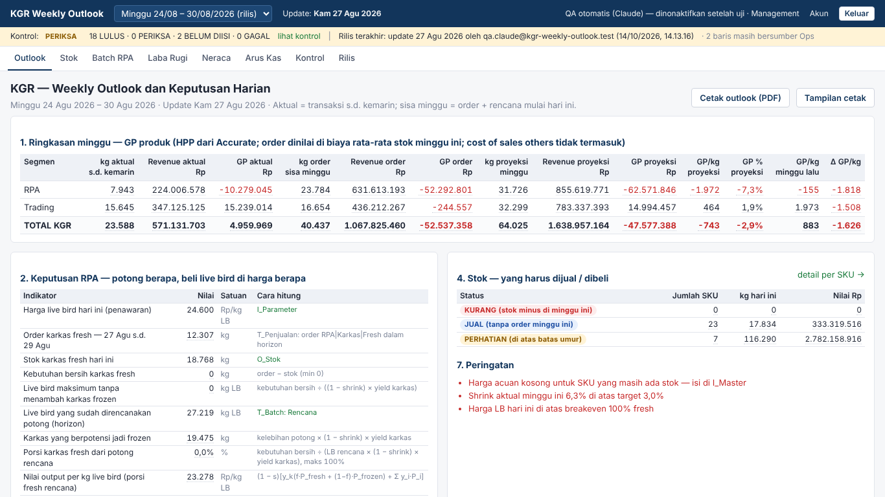
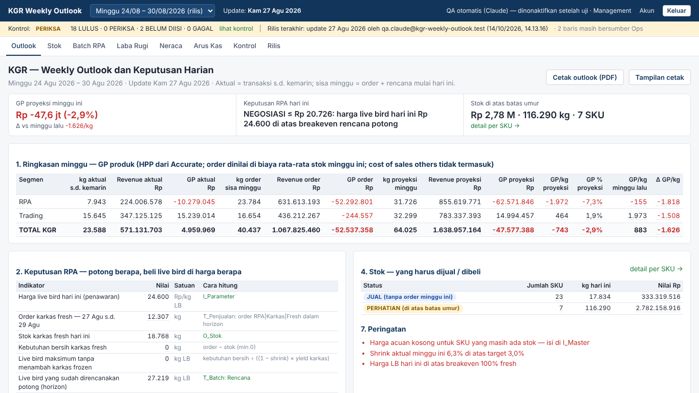
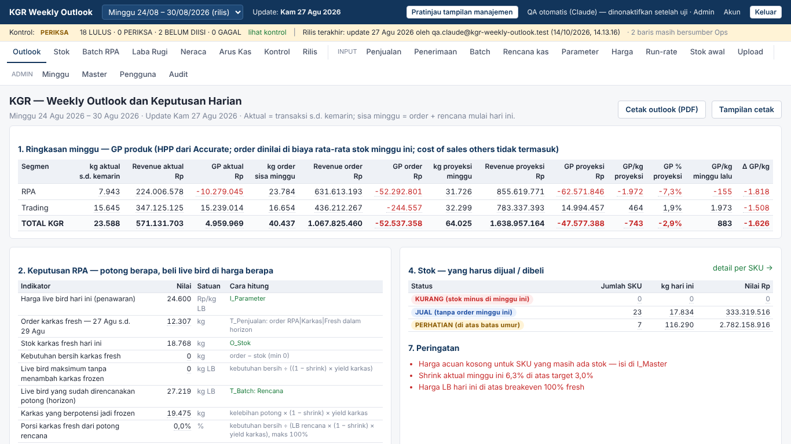
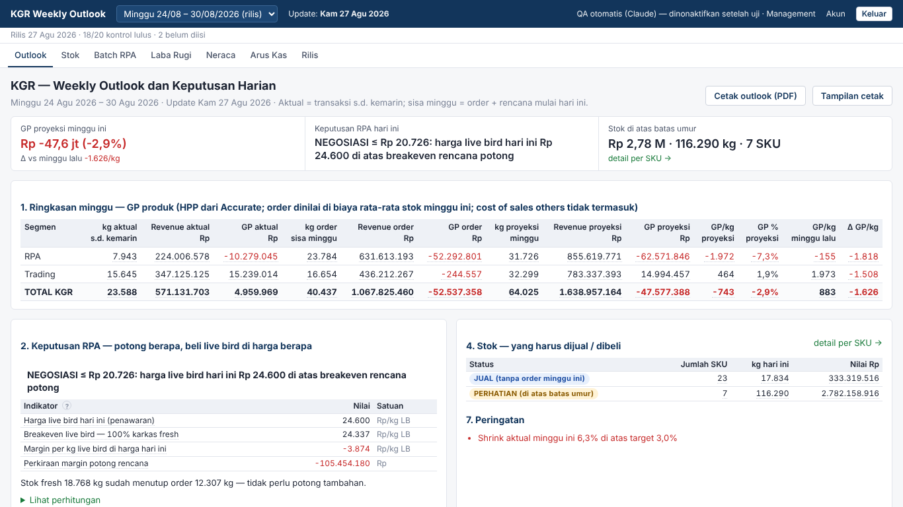
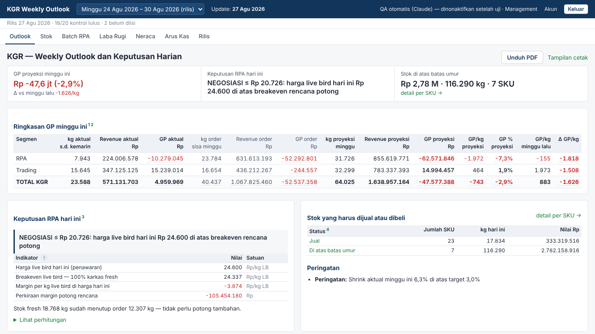
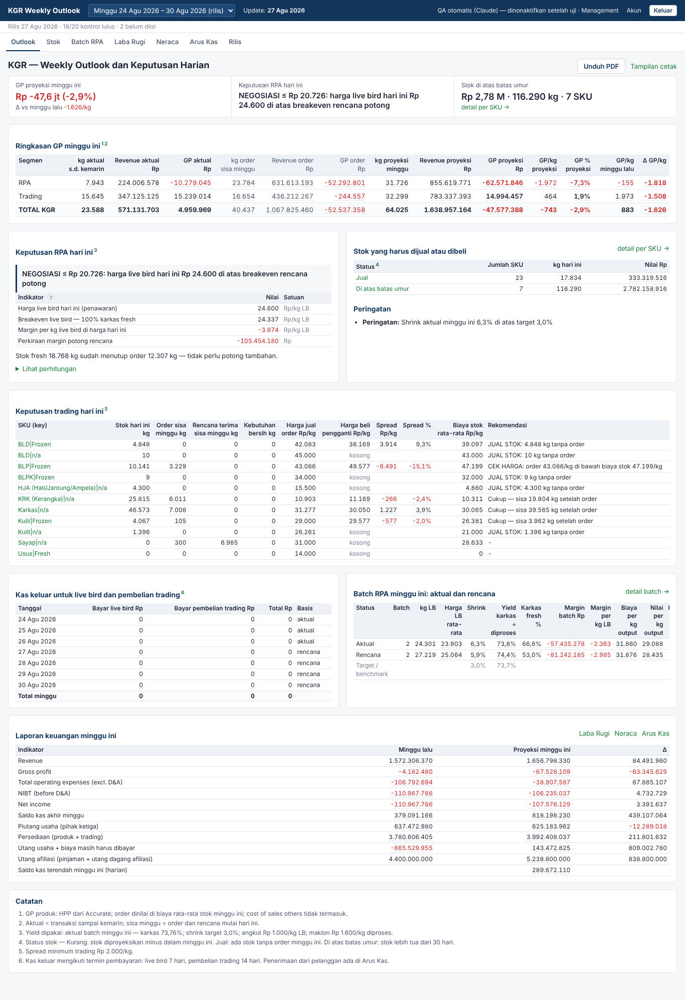

# Management View v2 — implementasi dan bukti

Spesifikasi: [`docs/PRD-management-view-v2.md`](../PRD-management-view-v2.md). Baseline angka: [`tests/snapshots/outlook-2026-08-24.before.json`](../../tests/snapshots/outlook-2026-08-24.before.json) (SHA-256 `947ce203…a83`), dicek oleh `pnpm snapshot:diff` dan tes `packages/engine/test/snapshot-baseline.test.ts` di CI.

**Status akhir (Tahap 4):** ketujuh kriteria PRD §5 PASS dengan bukti di bawah; view preparer tidak berubah selain tombol pratinjau dan baris stok 0 SKU yang abu-abu.

## Keputusan atas ambiguitas PRD (disetujui owner: "beresin sampai selesai" dengan usulan default)

| Tahap | Pertanyaan | Keputusan |
| --- | --- | --- |
| 1 | Role mana yang preparer? | Semua role selain `management` (admin, inventory accounting, finance, sales, PPIC, purchasing) = preparer dan bisa toggle; `management` selalu view manajemen. Sales/PPIC/Purchasing butuh menu INPUT, yang tidak dirender di view manajemen (R13). |
| 2 | Harga target NEGOSIASI = breakeven yang mana? | Breakeven porsi fresh rencana (B21) — yang berlaku untuk rencana potong hari ini. Pemetaan kode engine: `TUNDA / NEGOSIASI` → NEGOSIASI ≤ Rp B21 (TUNDA bila B21 ≤ 0); `KURANGI` dan `POTONG HANYA SESUAI ORDER` → POTONG {LB maksimum} kg; `LANJUT` → POTONG {LB rencana} kg. |
| 3 | R5 (nama teknis di `title`) vs §5 (tidak ada `I_`/`O_`/`T_` di DOM) | §5 menang: view manajemen tidak memuat nama teknis sama sekali; view preparer tetap. |
| 4 | R6–R16 untuk view mana? | Hanya view manajemen. View preparer tetap memakai nomor blok dan istilah Excel (spesifikasi awal). |

## Cara kerja view (R1)

- `apps/web/lib/view.ts`: `viewModeFor(role, cookie)` — `management` selalu `management`; role lain `preparer`, kecuali memilih pratinjau.
- Pilihan preparer disimpan di cookie `kgr_view` lewat server action `setViewMode` (`apps/web/app/view/actions.ts`); tombol di topbar (`components/ViewToggle.tsx`).
- Hanya tampilan. Hak baca/tulis tetap dari role dan RLS; preparer yang sedang pratinjau tetap bisa membuka halaman input lewat URL.
- `<main data-view="…">` menandai view yang aktif (dipakai pemeriksa otomatis).

## Bukti per tahap

Pemeriksa otomatis (Playwright, viewport 1366×768) dijalankan pada build produksi dengan akun uji: role `admin` (preparer) dan role `management`.

### Tahap 1 — R1 role split

Tes: engine 63, parser 10, web 3 lulus; `pnpm typecheck` dan `pnpm build` lulus.

| # | Kriteria (PRD §5) | Status | Bukti |
|---|---|---|---|
| 1 | Snapshot JSON engine minggu 24–30 Agu 2026 identik byte-per-byte (kecuali `warning.audience`, `recommendation.action`) | PASS | `pnpm snapshot:diff`: new fields present: block2.action=—; block7[].audience=—,—,— / diff vs baseline (without block2.action, block7[].audience): EMPTY — byte-identical |
| 2 | Login manajemen: tidak ada I_, O_, T_, @kgr-weekly-outlook, "bersumber Ops" di DOM | FAIL — dikerjakan di Tahap 3 (R5, R12) | grep page.content() (126549 char): I_/O_/T_: 152 (mis. «an class="tip" data-tip="T_Penjualan: Σ kg baris A»); @kgr-weekly-outlook: 2 (mis. «-> oleh <!-- -->qa.claude@kgr-weekly-outlook.test<»); bersumber Ops: 2 (mis. «-->2<!-- --> baris masih bersumber Ops</div») |
| 3 | Blok headline (R2) tampil di 1366×768 tanpa scroll | FAIL — dikerjakan di Tahap 2 (R2) | selector [data-headline] tidak ada |
| 4 | Rekomendasi mengandung tepat satu aksi dari enum | FAIL — dikerjakan di Tahap 2 (R4) | selector [data-reco] tidak ada |
| 5 | Tidak ada background merah/kuning kecuali teks nilai negatif | FAIL — dikerjakan di Tahap 3–4 (R8, R12) | 5 elemen, mis.: div.banner.PERIKSA rgb(255, 243, 214); span.badge.PERIKSA rgb(255, 243, 214); div.reco.bad rgb(253, 236, 236); span.badge.KURANG rgb(253, 236, 236); span.badge.PERHATIAN rgb(255, 243, 214) |
| 6 | Preparer bisa toggle ke view manajemen dan kembali | PASS | HTTP 200; main[data-view]: preparer → klik "Pratinjau tampilan manajemen" → management (/w/2026-08-24/outlook) → klik "Kembali ke tampilan penyusun" → preparer |
| 7 | Tab keyboard menjangkau tooltip R5 dan link "detail per SKU" | FAIL — dikerjakan di Tahap 2–3 (R2, R5) | tooltip R5 [data-r5-tip]: tidak terjangkau/tidak ada; link [data-detail-sku]: tidak terjangkau/tidak ada |
| + | Role manajemen selalu view manajemen (R1) | PASS | HTTP 200; main[data-view]=management; tombol toggle tidak ada |

| Preparer (1366×768) | Manajemen (1366×768) |
| --- | --- |
|  |  |

### Tahap 2 — R2, R4, R9 (baris nol)

Tes: engine 65, parser 10, web 3 lulus; `pnpm typecheck` dan `pnpm build` lulus.

| # | Kriteria (PRD §5) | Status | Bukti |
|---|---|---|---|
| 1 | Snapshot JSON engine minggu 24–30 Agu 2026 identik byte-per-byte (kecuali `warning.audience`, `recommendation.action`) | PASS | `pnpm snapshot:diff`: new fields present: block2.action={"kind":"NEGOSIASI","targetPrice":"20725.657457","kg":null,"text":"NEGOSIASI ≤ Rp 20.726: harga live bird hari ini Rp 24.600 di atas breakeven rencana potong"}; block7[].audience=—,—,— / diff vs baseline (without block2.action, block7[].audience): EMPTY — byte-identical |
| 2 | Login manajemen: tidak ada I_, O_, T_, @kgr-weekly-outlook, "bersumber Ops" di DOM | FAIL — dikerjakan di Tahap 3 (R5, R12) | grep page.content() (127465 char): I_/O_/T_: 150 (mis. «an class="tip" data-tip="T_Penjualan: Σ kg baris A»); @kgr-weekly-outlook: 2 (mis. «-> oleh <!-- -->qa.claude@kgr-weekly-outlook.test<»); bersumber Ops: 2 (mis. «-->2<!-- --> baris masih bersumber Ops</div») |
| 3 | Blok headline (R2) tampil di 1366×768 tanpa scroll | PASS | [data-headline] y=183 tinggi=83 → bawah 266 px ≤ 768 (scrollY=0, viewport 1366×768) |
| 4 | Rekomendasi mengandung tepat satu aksi dari enum | PASS | [data-reco] «NEGOSIASI ≤ Rp 20.726: harga live bird hari ini Rp 24.600 di atas breakeven rencana potong» → aksi: NEGOSIASI ≤ Rp 20.726; [data-reco] «NEGOSIASI ≤ Rp 20.726: harga live bird hari ini Rp 24.600 di atas breakeven rencana potong» → aksi: NEGOSIASI ≤ Rp 20.726 |
| 5 | Tidak ada background merah/kuning kecuali teks nilai negatif | FAIL — dikerjakan di Tahap 3–4 (R8, R9, R12) | 3 elemen, mis.: div.banner.PERIKSA rgb(255, 243, 214); span.badge.PERIKSA rgb(255, 243, 214); span.badge.PERHATIAN rgb(255, 243, 214) |
| 6 | Preparer bisa toggle ke view manajemen dan kembali | PASS | HTTP 200; main[data-view]: preparer → klik "Pratinjau tampilan manajemen" → management (/w/2026-08-24/outlook) → klik "Kembali ke tampilan penyusun" → preparer |
| 7 | Tab keyboard menjangkau tooltip R5 dan link "detail per SKU" | FAIL — tooltip R5 dikerjakan di Tahap 3 | tooltip R5 [data-r5-tip]: tidak terjangkau/tidak ada; link [data-detail-sku]: Tab ke-16 («detail per SKU →») |
| + | Role manajemen selalu view manajemen (R1) | PASS | HTTP 200; main[data-view]=management; tombol toggle tidak ada |

| Preparer (1366×768) | Manajemen (1366×768) |
| --- | --- |
|  |  |

### Tahap 3 — R3, R5, R10, R12, R13

Tes: engine 66, parser 10, web 5 lulus; `pnpm typecheck` dan `pnpm build` lulus. Halaman Rilis, Kontrol, Stok, Laba Rugi untuk role manajemen: 0 email, nav 7 menu, baris rilis abu.

| # | Kriteria (PRD §5) | Status | Bukti |
|---|---|---|---|
| 1 | Snapshot JSON engine minggu 24–30 Agu 2026 identik byte-per-byte (kecuali `warning.audience`, `recommendation.action`) | PASS | `pnpm snapshot:diff`: new fields present: block2.action={"kind":"NEGOSIASI","targetPrice":"20725.657457","kg":null,"text":"NEGOSIASI ≤ Rp 20.726: harga live bird hari ini Rp 24.600 di atas breakeven rencana potong"}; block7[].audience=preparer,management,management / diff vs baseline (without block2.action, block7[].audience): EMPTY — byte-identical |
| 2 | Login manajemen: tidak ada I_, O_, T_, @kgr-weekly-outlook, "bersumber Ops" di DOM | PASS | grep page.content() (125055 char): I_/O_/T_: 0; @kgr-weekly-outlook: 0; bersumber Ops: 0 |
| 3 | Blok headline (R2) tampil di 1366×768 tanpa scroll | PASS | [data-headline] y=176 tinggi=83 → bawah 259 px ≤ 768 (scrollY=0, viewport 1366×768) |
| 4 | Rekomendasi mengandung tepat satu aksi dari enum | PASS | [data-reco] «NEGOSIASI ≤ Rp 20.726: harga live bird hari ini Rp 24.600 di atas breakeven rencana potong» → aksi: NEGOSIASI ≤ Rp 20.726; [data-reco] «NEGOSIASI ≤ Rp 20.726: harga live bird hari ini Rp 24.600 di atas breakeven rencana potong» → aksi: NEGOSIASI ≤ Rp 20.726 |
| 5 | Tidak ada background merah/kuning kecuali teks nilai negatif | FAIL — dikerjakan di Tahap 4 (R9: pill diganti teks) | 1 elemen, mis.: span.badge.PERHATIAN rgb(255, 243, 214) |
| 6 | Preparer bisa toggle ke view manajemen dan kembali | PASS | HTTP 200; main[data-view]: preparer → klik "Pratinjau tampilan manajemen" → management (/w/2026-08-24/outlook) → klik "Kembali ke tampilan penyusun" → preparer |
| 7 | Tab keyboard menjangkau tooltip R5 dan link "detail per SKU" | PASS | tooltip R5 [data-r5-tip]: Tab ke-55 («Harga live bird hari ini (penawaran)»); link [data-detail-sku]: Tab ke-15 («detail per SKU →») |
| + | Role manajemen selalu view manajemen (R1) | PASS | HTTP 200; main[data-view]=management; tombol toggle tidak ada |

| Preparer (1366×768) | Manajemen (1366×768) |
| --- | --- |
|  |  |

### Tahap 4 — R6, R7, R8, R9 (status teks), R11, R14, R15, R16

Tes: engine 66, parser 10, web 5 lulus; `pnpm typecheck` dan `pnpm build` lulus; sapuan 29 halaman + PDF/CSV/JSON: semua 200.

| # | Kriteria (PRD §5) | Status | Bukti |
|---|---|---|---|
| 1 | Snapshot JSON engine minggu 24–30 Agu 2026 identik byte-per-byte (kecuali `warning.audience`, `recommendation.action`) | PASS | `pnpm snapshot:diff`: new fields present: block2.action={"kind":"NEGOSIASI","targetPrice":"20725.657457","kg":null,"text":"NEGOSIASI ≤ Rp 20.726: harga live bird hari ini Rp 24.600 di atas breakeven rencana potong"}; block7[].audience=preparer,management,management / diff vs baseline (without block2.action, block7[].audience): EMPTY — byte-identical |
| 2 | Login manajemen: tidak ada I_, O_, T_, @kgr-weekly-outlook, "bersumber Ops" di DOM | PASS | grep page.content() (125608 char): I_/O_/T_: 0; @kgr-weekly-outlook: 0; bersumber Ops: 0 |
| 3 | Blok headline (R2) tampil di 1366×768 tanpa scroll | PASS | [data-headline] y=151 tinggi=83 → bawah 234 px ≤ 768 (scrollY=0, viewport 1366×768) |
| 4 | Rekomendasi mengandung tepat satu aksi dari enum | PASS | [data-reco] «NEGOSIASI ≤ Rp 20.726: harga live bird hari ini Rp 24.600 di atas breakeven rencana potong» → aksi: NEGOSIASI ≤ Rp 20.726; [data-reco] «NEGOSIASI ≤ Rp 20.726: harga live bird hari ini Rp 24.600 di atas breakeven rencana potong» → aksi: NEGOSIASI ≤ Rp 20.726 |
| 5 | Tidak ada background merah/kuning kecuali teks nilai negatif | PASS | computed background-color semua elemen body: tidak ada hue merah/kuning (s>0,3) |
| 6 | Preparer bisa toggle ke view manajemen dan kembali | PASS | HTTP 200; main[data-view]: preparer → klik "Pratinjau tampilan manajemen" → management (/w/2026-08-24/outlook) → klik "Kembali ke tampilan penyusun" → preparer |
| 7 | Tab keyboard menjangkau tooltip R5 dan link "detail per SKU" | PASS | tooltip R5 [data-r5-tip]: Tab ke-58 («Harga live bird hari ini (penawaran)»); link [data-detail-sku]: Tab ke-15 («detail per SKU →») |
| + | Role manajemen selalu view manajemen (R1) | PASS | HTTP 200; main[data-view]=management; tombol toggle tidak ada |

| Preparer (1366×768) | Manajemen (1366×768) |
| --- | --- |
|  |  |

Halaman penuh view manajemen: 

### Perbaikan setelah review (temuan Codex di PR #3 dan #4)

| Temuan | Perbaikan | Bukti |
| --- | --- | --- |
| P1 (#3): `LANJUT` → "POTONG {rencana} kg" walau rencana belum menutup order fresh | `LANJUT` dengan rencana < LB maksimum − 0,5 kg → `POTONG {LB maksimum} kg LB: rencana … kg belum menutup order fresh` | tes `rules.test.ts`: rencana 1.000 kg vs order 100.000 kg; rencana 0 kg → "POTONG 1.399 kg LB: rencana 0 kg belum menutup order fresh"; rencana = kebutuhan → tetap POTONG rencana |
| P2 (#4): angka kontrol di baris rilis dihitung dari data live, bukan dari rilis | Bila jumlah per status berbeda dari yang dibekukan di rilis terakhir, baris menyebut "data berubah sejak rilis" | update 27 Agu: "Rilis 27 Agu 2026 · 18/20 kontrol lulus · 2 belum diisi"; diubah ke 28 Agu: "Rilis 27 Agu 2026 · data berubah sejak rilis · 16/20 kontrol lulus · 2 belum diisi · 2 perlu diperiksa"; dikembalikan ke 27 Agu |
| P2 (#4): header manajemen jatuh ke email bila nama kosong | View manajemen hanya menampilkan nama (bila ada) dan role | akun uji tanpa nama: header "Management", 0 alamat email di DOM |

Kriteria PRD §5 dijalankan ulang setelah perbaikan: semua PASS; snapshot database = snapshot engine (SHA-256 `162ade6b…`, sudah termasuk field baru).
