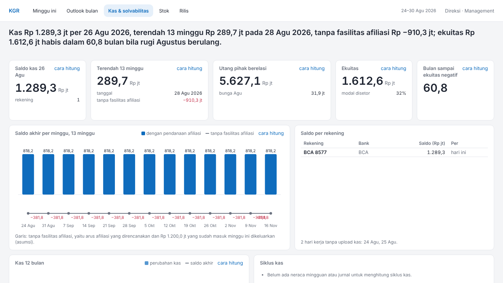
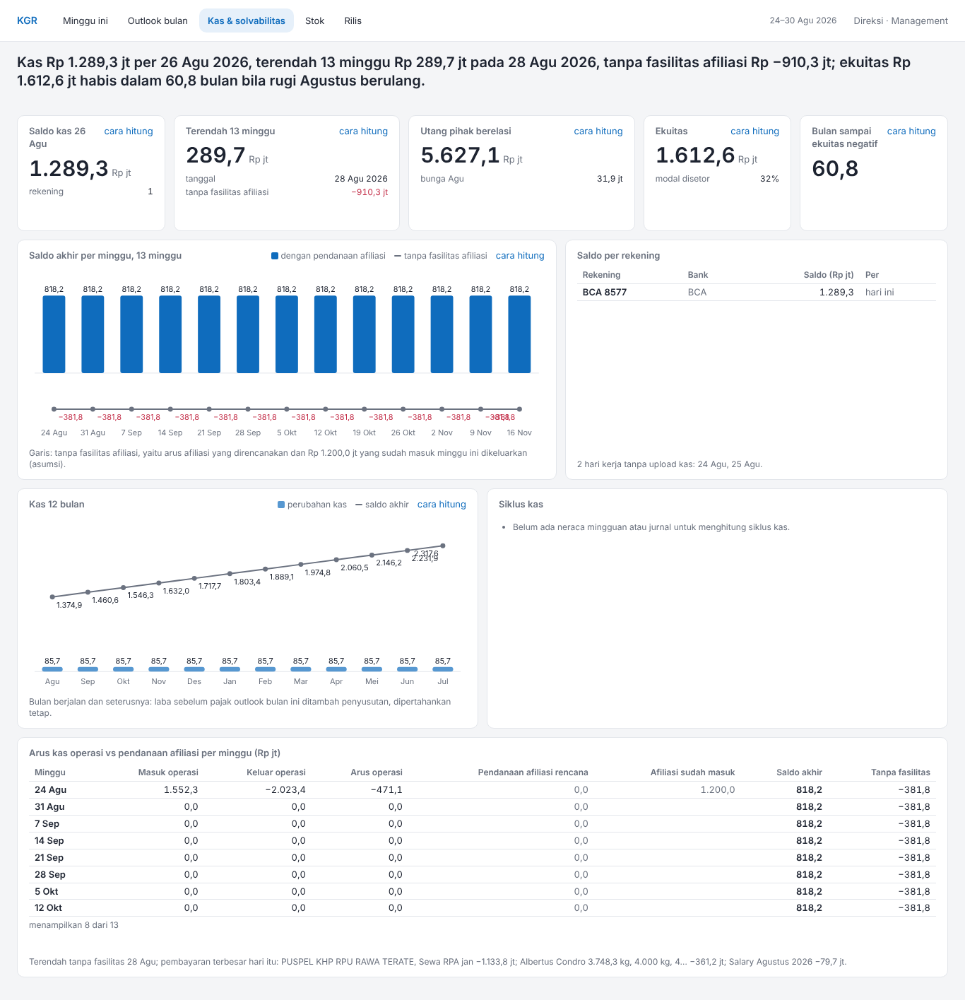

# Banding screenshot: kas-solvabilitas-proyeksi

Mockup `reference/design/kas-solvabilitas.html` lawan halaman `kas-solvabilitas-proyeksi.html` dari harness fixture (`apps/web/scripts/v4-fixture.tsx`), viewport 1366×768. Pasangan gambar di `img/`.

| Mockup (1366×768) | Halaman (1366×768) |
| --- | --- |
|  |  |

| Mockup (penuh) | Halaman (penuh) |
| --- | --- |
|  |  |

## Above the fold

LULUS: baris 0–3 (headline, c-saldo, c-terendah, c-afiliasi, c-ekuitas, c-bulan-negatif, ch-13minggu, t-rekening) berakhir di atas 768px (paling bawah 679px), scrollY = 0.

## Grep DOM halaman

| Pola | Jumlah | Contoh |
| --- | --- | --- |
| I_, O_, T_ (nama lembar teknis) | 0 |  |
| alamat e-mail | 0 |  |
| "bersumber Ops" | 0 |  |
| "→" | 0 |  |
| "M " sebagai satuan | 0 |  |
| # hex inline (style=) | 0 |  |
| fontSize inline | 0 |  |

## Kontras token (§5.2)

| Pasangan | Rasio | Minimum | |
| --- | --- | --- | --- |
| teks --text di atas --surface | 15,73:1 | 4.5:1 | lulus |
| --muted di atas --surface | 4,98:1 | 4.5:1 | lulus |
| --muted di atas --bg | 4,57:1 | 4.5:1 | lulus |
| --bad (teks) di atas --surface | 5,40:1 | 4.5:1 | lulus |
| --good (teks) di atas --surface | 5,02:1 | 4.5:1 | lulus |
| --accent (teks) di atas --surface | 5,38:1 | 4.5:1 | lulus |
| --accent di atas --accent-soft | 4,67:1 | 4.5:1 | lulus |
| bar --chart-1 vs --surface | 5,38:1 | 3:1 | lulus |
| bar --chart-2 vs --surface | 3,08:1 | 3:1 | lulus |
| bar --chart-3 vs --surface | 4,83:1 | 3:1 | lulus |

## Selisih per tile (16)

Tile di mockup: 11; di halaman: 11.

| Tile | Aspek | Mockup | Halaman |
| --- | --- | --- | --- |
| headline | nilai | Kas Rp 103,0 jt per 30 Sep 2026; ekuitas Rp 702,6 jt habis dalam 0,8 bulan bila rugi September berulang. | Kas Rp 1.289,3 jt per 26 Agu 2026, terendah 13 minggu Rp 289,7 jt pada 28 Agu 2026, tanpa fasilitas afiliasi Rp −910,3 jt; ekuitas Rp 1.612,6 jt habis dalam 60,8 bulan bila rugi Agustus berulang. |
| c-saldo | judul | Saldo kas 30 Sep | Saldo kas 26 Agu |
| c-saldo | nilai | 103,0 | 1.289,3 / 1 |
| c-terendah | nilai | tidak tersedia | 289,7 / 28 Agu 2026 / −910,3 jt |
| c-afiliasi | nilai | 9.845,9 / 4.218,8 jt / 54,0 jt | 5.627,1 / 31,9 jt |
| c-ekuitas | nilai | 702,6 / 14% | 1.612,6 / 32% |
| c-bulan-negatif | nilai | 0,8 | 60,8 |
| ch-13minggu | nilai | tidak ada data untuk periode ini |  |
| ch-13minggu | catatan | (tanpa catatan) | Garis: tanpa fasilitas afiliasi, yaitu arus afiliasi yang direncanakan dan Rp 1.200,0 jt yang sudah masuk minggu ini dikeluarkan (asumsi). |
| t-rekening | nilai | tidak ada data untuk periode ini |  |
| t-rekening | catatan | (tanpa catatan) | 2 hari kerja tanpa upload kas: 24 Agu, 25 Agu. |
| ch-12bulan | nilai | tidak tersedia: outlook bulanan belum menjadi basis |  |
| ch-12bulan | catatan | (tanpa catatan) | Bulan berjalan dan seterusnya: laba sebelum pajak outlook bulan ini ditambah penyusutan, dipertahankan tetap. |
| ccc | nilai |  | Belum ada neraca mingguan atau jurnal untuk menghitung siklus kas. |
| t-arus | judul | Arus kas operasi vs pendanaan afiliasi, minggu 24–30 Agu (Rp jt) | Arus kas operasi vs pendanaan afiliasi per minggu (Rp jt) |
| t-arus | catatan | (tanpa catatan) | Terendah tanpa fasilitas 28 Agu; pembayaran terbesar hari itu: PUSPEL KHP RPU RAWA TERATE, Sewa RPA jan −1.133,8 jt; Albertus Condro 3.748,3 kg, 4.000 kg, 4… −361,2 jt; Salary Agustus 2026 −79,7 jt. |
