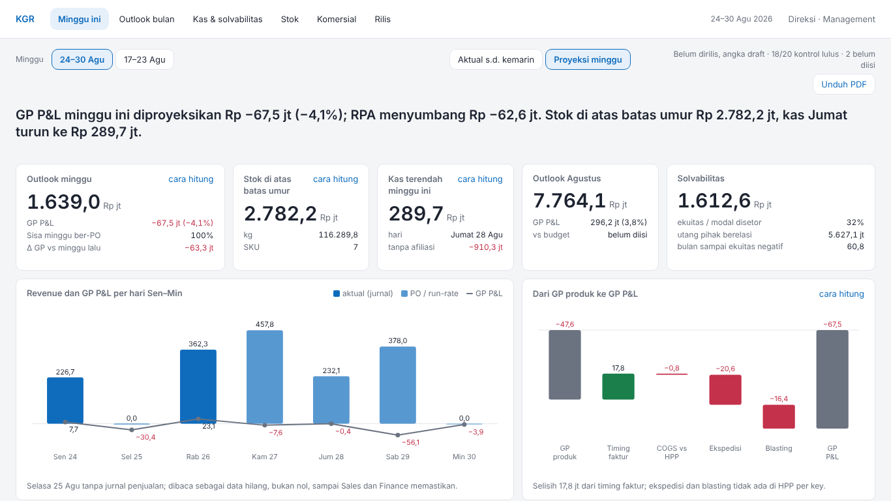
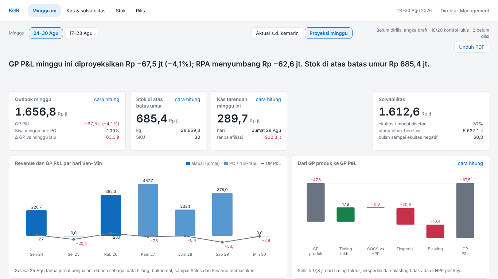
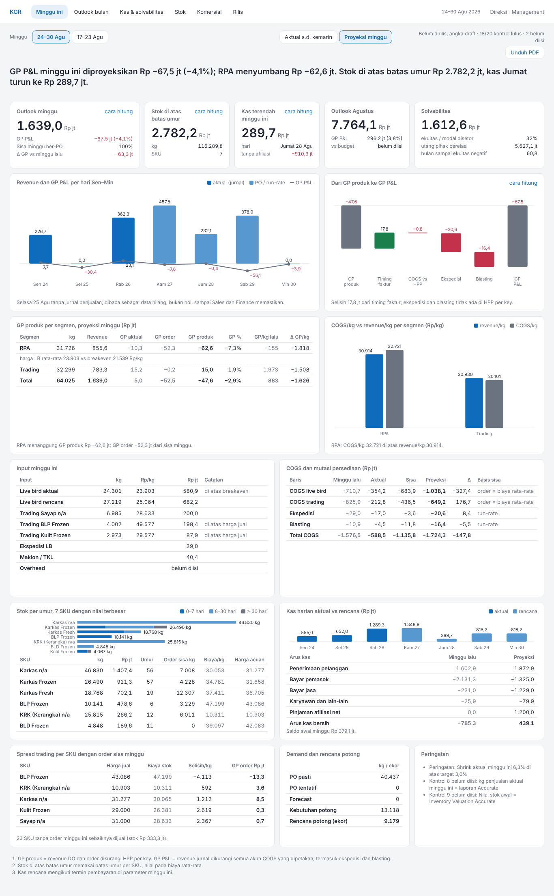
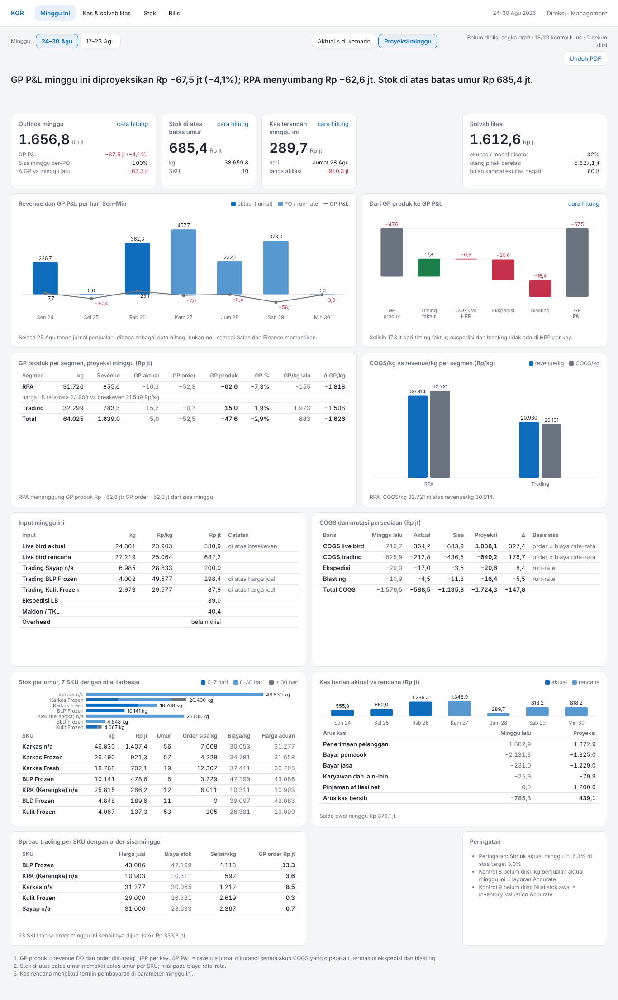

# Banding screenshot: minggu-ini

Mockup `reference/design/minggu-ini.html` lawan halaman `/tmp/claude-0/-home-user-KGR-Weekly-Outlook/8c03e063-7661-52a8-b410-b276826414d1/scratchpad/v4html/minggu-ini.html`, viewport 1366×768. Pasangan gambar di `img/`.

| Mockup (1366×768) | Halaman (1366×768) |
| --- | --- |
|  |  |

| Mockup (penuh) | Halaman (penuh) |
| --- | --- |
|  |  |

## Above the fold

LULUS: baris 0–3 (slicer-minggu, mode, rilis, headline, c-outlook, c-stok, c-kas, c-solvabilitas) berakhir di atas 768px (paling bawah 415px), scrollY = 0.

## Grep DOM halaman

| Pola | Jumlah | Contoh |
| --- | --- | --- |
| I_, O_, T_ (nama lembar teknis) | 0 |  |
| alamat e-mail | 0 |  |
| "bersumber Ops" | 0 |  |
| "→" | 0 |  |
| "M " sebagai satuan | 0 |  |
| # hex inline (style=) | 0 |  |
| fontSize inline | 0 |  |

## Kontras token (§5.2)

| Pasangan | Rasio | Minimum | |
| --- | --- | --- | --- |
| teks --text di atas --surface | 15,73:1 | 4.5:1 | lulus |
| --muted di atas --surface | 4,98:1 | 4.5:1 | lulus |
| --muted di atas --bg | 4,57:1 | 4.5:1 | lulus |
| --bad (teks) di atas --surface | 5,40:1 | 4.5:1 | lulus |
| --good (teks) di atas --surface | 5,02:1 | 4.5:1 | lulus |
| --accent (teks) di atas --surface | 5,38:1 | 4.5:1 | lulus |
| --accent di atas --accent-soft | 4,67:1 | 4.5:1 | lulus |
| bar --chart-1 vs --surface | 5,38:1 | 3:1 | lulus |
| bar --chart-2 vs --surface | 3,08:1 | 3:1 | lulus |
| bar --chart-3 vs --surface | 4,83:1 | 3:1 | lulus |

## Selisih per tile (5)

Tile di mockup: 21; di halaman: 19.

| Tile | Aspek | Mockup | Halaman |
| --- | --- | --- | --- |
| headline | nilai | GP P&L minggu ini diproyeksikan Rp −67,5 jt (−4,1%); RPA menyumbang Rp −62,6 jt. Stok di atas batas umur Rp 2.782,2 jt, kas Jumat turun ke Rp 289,7 jt. | GP P&L minggu ini diproyeksikan Rp −67,5 jt (−4,1%); RPA menyumbang Rp −62,6 jt. Stok di atas batas umur Rp 685,4 jt. |
| c-outlook | nilai | 1.639,0 / −67,5 jt (−4,1%) / 100% / −63,3 jt | 1.656,8 / −67,5 jt (−4,1%) / 100% / −63,3 jt |
| c-stok | nilai | 2.782,2 / 116.289,8 / 7 | 685,4 / 38.659,8 / 30 |
| c-bulan | tile | ada di mockup | tidak dirender di halaman |
| demand | tile | ada di mockup | tidak dirender di halaman |
