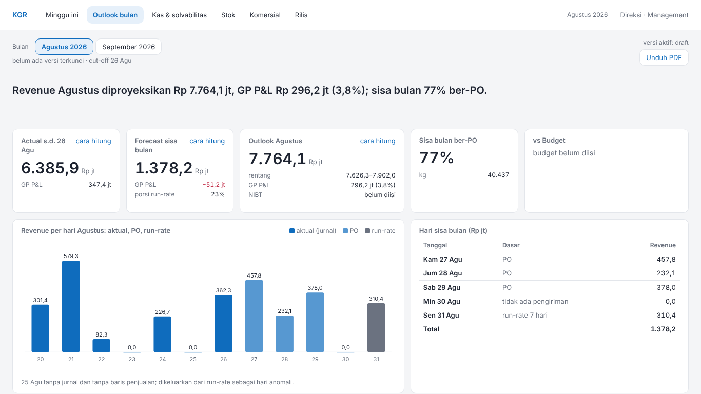
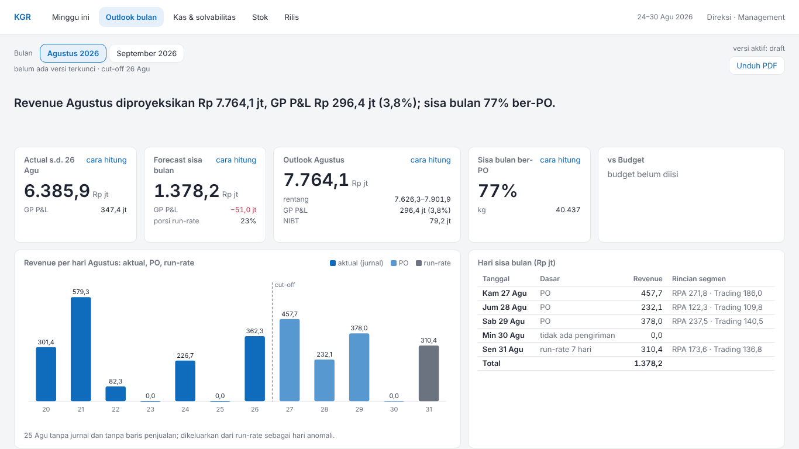
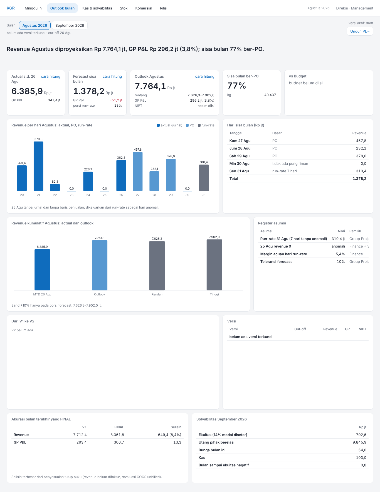
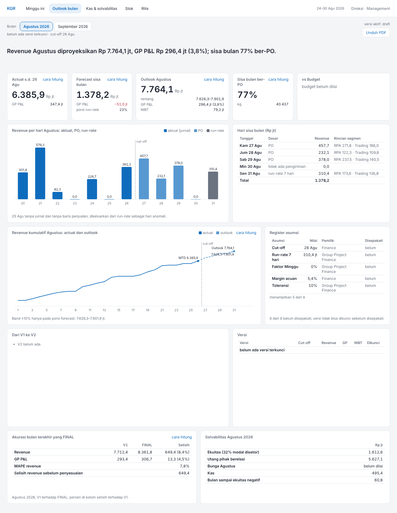

# Banding screenshot: outlook-bulan

Mockup `reference/design/outlook-bulan.html` lawan halaman `outlook-bulan.html` dari harness fixture (`apps/web/scripts/v4-fixture.tsx`), viewport 1366×768. Pasangan gambar di `img/`.

| Mockup (1366×768) | Halaman (1366×768) |
| --- | --- |
|  |  |

| Mockup (penuh) | Halaman (penuh) |
| --- | --- |
|  |  |

## Above the fold

LULUS: baris 0–3 (slicer-bulan, rilis, headline, c-actual, c-forecast, c-outlook, c-po, c-budget) berakhir di atas 768px (paling bawah 415px), scrollY = 0.

## Grep DOM halaman

| Pola | Jumlah | Contoh |
| --- | --- | --- |
| I_, O_, T_ (nama lembar teknis) | 0 |  |
| alamat e-mail | 0 |  |
| "bersumber Ops" | 0 |  |
| "→" | 0 |  |
| "M " sebagai satuan | 0 |  |
| # hex inline (style=) | 0 |  |
| fontSize inline | 0 |  |

## Kontras token (§5.2)

| Pasangan | Rasio | Minimum | |
| --- | --- | --- | --- |
| teks --text di atas --surface | 15,73:1 | 4.5:1 | lulus |
| --muted di atas --surface | 4,98:1 | 4.5:1 | lulus |
| --muted di atas --bg | 4,57:1 | 4.5:1 | lulus |
| --bad (teks) di atas --surface | 5,40:1 | 4.5:1 | lulus |
| --good (teks) di atas --surface | 5,02:1 | 4.5:1 | lulus |
| --accent (teks) di atas --surface | 5,38:1 | 4.5:1 | lulus |
| --accent di atas --accent-soft | 4,67:1 | 4.5:1 | lulus |
| bar --chart-1 vs --surface | 5,38:1 | 3:1 | lulus |
| bar --chart-2 vs --surface | 3,08:1 | 3:1 | lulus |
| bar --chart-3 vs --surface | 4,83:1 | 3:1 | lulus |

## Selisih per tile (7)

Tile di mockup: 16; di halaman: 16.

| Tile | Aspek | Mockup | Halaman |
| --- | --- | --- | --- |
| headline | nilai | Revenue Agustus diproyeksikan Rp 7.764,1 jt, GP P&L Rp 296,2 jt (3,8%); sisa bulan 77% ber-PO. | Revenue Agustus diproyeksikan Rp 7.764,1 jt, GP P&L Rp 296,4 jt (3,8%); sisa bulan 77% ber-PO. |
| c-forecast | nilai | 1.378,2 / −51,2 jt / 23% | 1.378,2 / −51,0 jt / 23% |
| c-outlook | nilai | 7.764,1 / 7.626,3–7.902,0 / 296,2 jt (3,8%) / belum diisi | 7.764,1 / 7.626,3–7.901,9 / 296,4 jt (3,8%) / 79,2 jt |
| ch-kumulatif | catatan | Band ±10% hanya pada porsi forecast: 7.626,3–7.902,0 jt. | Band ±10% hanya pada porsi forecast: 7.626,3–7.901,9 jt. |
| register | catatan | (tanpa catatan) | 8 dari 8 belum disepakati; versi tidak bisa dikunci sebelum disepakati. |
| akurasi | catatan | Selisih terbesar dari penyesuaian tutup buku (revenue belum difaktur, revaluasi COGS unbilled). | Agustus 2026, V1 terhadap FINAL; persen di kolom selisih terhadap V1. |
| solvabilitas | judul | Solvabilitas September 2026 | Solvabilitas Agustus 2026 |
