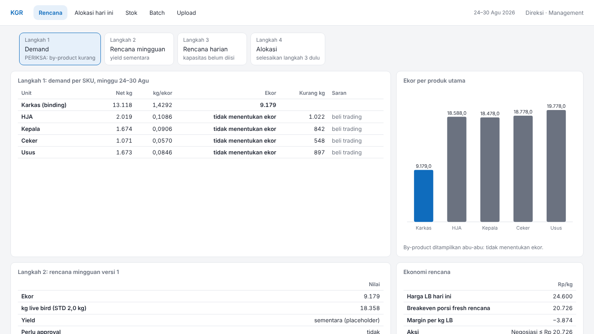
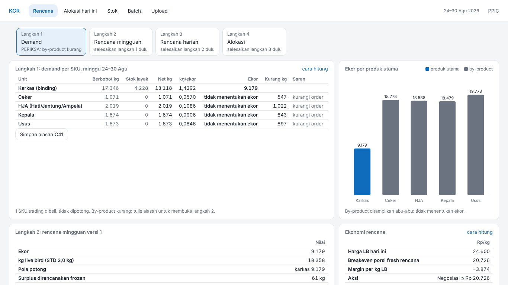
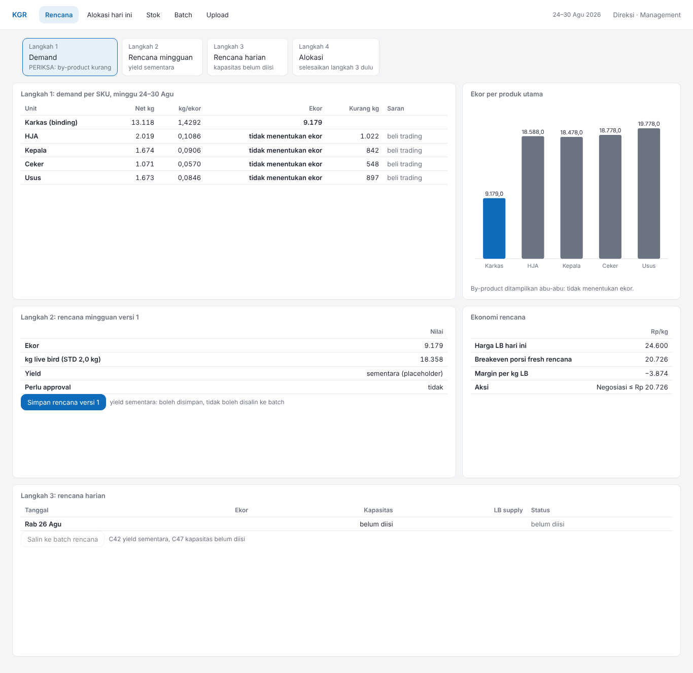
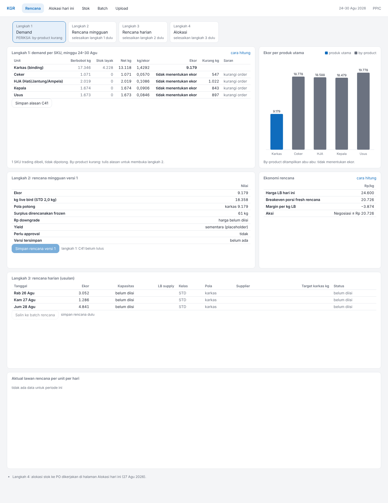

# Banding screenshot: ppic-rencana

Mockup `reference/design/ppic-rencana.html` lawan halaman `ppic-rencana.html` dari harness fixture (`apps/web/scripts/v4-fixture.tsx`), viewport 1366×768. Pasangan gambar di `img/`.

| Mockup (1366×768) | Halaman (1366×768) |
| --- | --- |
|  |  |

| Mockup (penuh) | Halaman (penuh) |
| --- | --- |
|  |  |

## Above the fold

LULUS: baris 0–3 (stepper, t-demand, ch-ekor) berakhir di atas 768px (paling bawah 591px), scrollY = 0.

## Grep DOM halaman

| Pola | Jumlah | Contoh |
| --- | --- | --- |
| I_, O_, T_ (nama lembar teknis) | 0 |  |
| alamat e-mail | 0 |  |
| "bersumber Ops" | 0 |  |
| "→" | 0 |  |
| "M " sebagai satuan | 0 |  |
| # hex inline (style=) | 0 |  |
| fontSize inline | 0 |  |

## Kontras token (§5.2)

| Pasangan | Rasio | Minimum | |
| --- | --- | --- | --- |
| teks --text di atas --surface | 15,73:1 | 4.5:1 | lulus |
| --muted di atas --surface | 4,98:1 | 4.5:1 | lulus |
| --muted di atas --bg | 4,57:1 | 4.5:1 | lulus |
| --bad (teks) di atas --surface | 5,40:1 | 4.5:1 | lulus |
| --good (teks) di atas --surface | 5,02:1 | 4.5:1 | lulus |
| --accent (teks) di atas --surface | 5,38:1 | 4.5:1 | lulus |
| --accent di atas --accent-soft | 4,67:1 | 4.5:1 | lulus |
| bar --chart-1 vs --surface | 5,38:1 | 3:1 | lulus |
| bar --chart-2 vs --surface | 3,08:1 | 3:1 | lulus |
| bar --chart-3 vs --surface | 4,83:1 | 3:1 | lulus |

## Selisih per tile (4)

Tile di mockup: 6; di halaman: 8.

| Tile | Aspek | Mockup | Halaman |
| --- | --- | --- | --- |
| t-demand | catatan | (tanpa catatan) | 1 SKU trading dibeli, tidak dipotong. By-product kurang: tulis alasan untuk membuka langkah 2. |
| t-harian | judul | Langkah 3: rencana harian | Langkah 3: rencana harian (usulan) |
| t-varian | tile | tidak ada di mockup | ada di halaman |
| link-alokasi | tile | tidak ada di mockup | ada di halaman |
